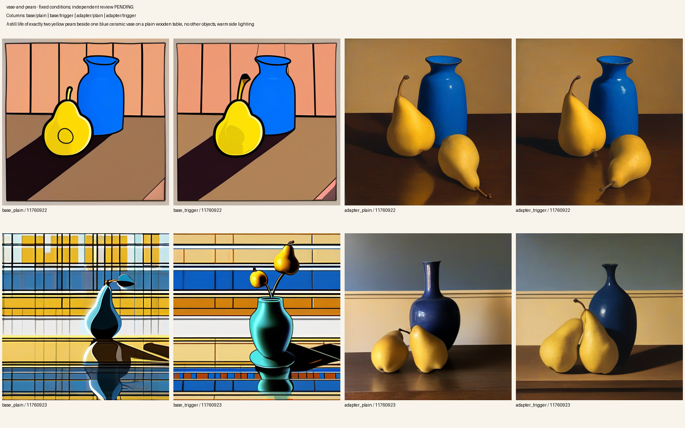
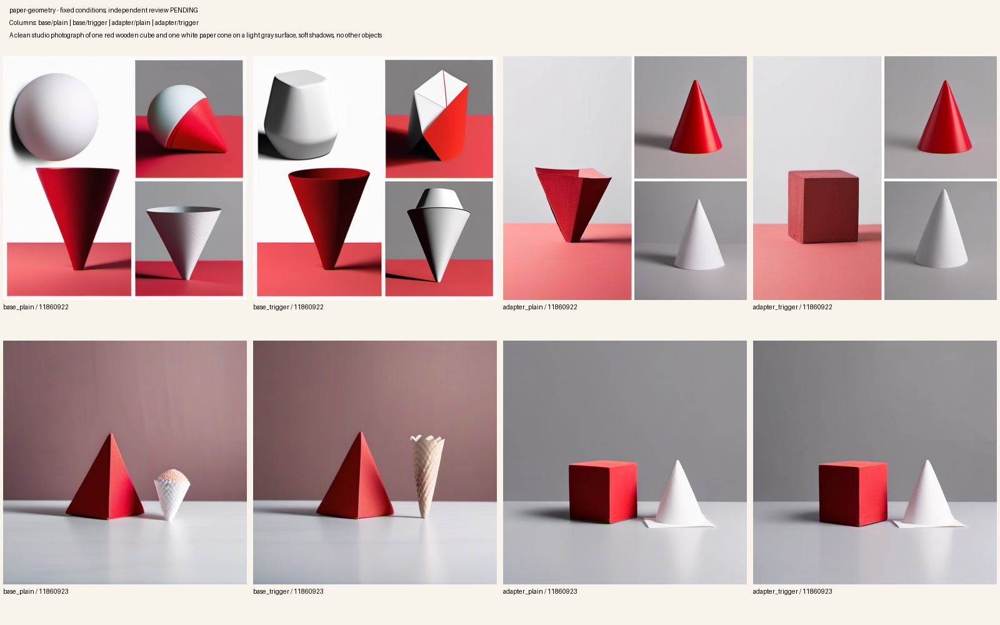
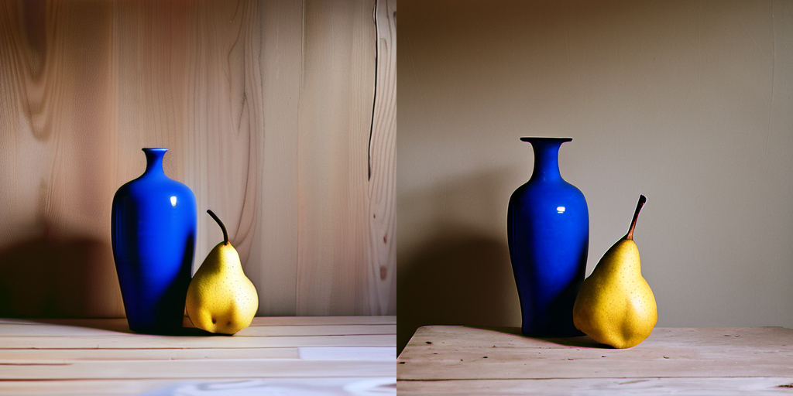
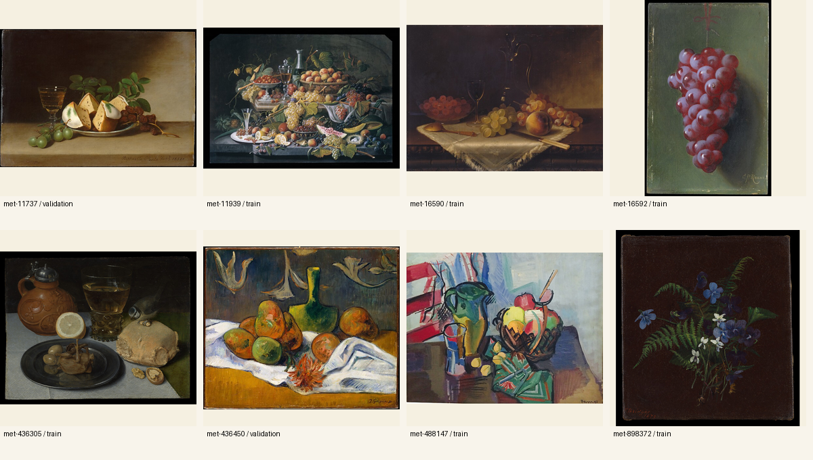

# Stage 11B independent review packet

**Current disposition: rejected by assistant review; candidate remains unpromoted.** The user shelved the mandatory human gate after this packet was created. [The v3 reassessment](../review-policy-reassessment-20260922.json) records the actual observations and policy revision. The image sheets and original packet IDs below remain historical evidence; their embedded "human pending" labels are superseded.

Packet: `b7f6c2f6edb501191c08ac0d3b0313793f7ef93a9247d912b2da71daada781c7`  
Candidate: `b1eeb9951d2a880b0573a12d4cf5679469b70f72f032b521d9021189cc28b96a`

Inspect both rows of each sheet. Columns are **base without trigger**, **base with trigger**, **adapter without trigger**, **adapter with trigger**. Each row uses the same seed across all four conditions. Labels are disclosed; this is an independent review, not a blinded experiment. Each original 512px image is retained beside these sheets.

## Held-out composition

Prompt: “A still life of exactly two yellow pears beside one blue ceramic vase on a plain wooden table, no other objects, warm side lighting.” Seeds: 11760922 and 11760923.

Judge whether both pears and the vase are distinct, object count and colors are correct, the composition is coherent, and the intended oil-painted appearance is useful. Compare the trigger's effect both with and without the adapter; a change from adding the token to the base model is not learned activation evidence.

## Regression composition

Prompt: “A clean studio photograph of one red wooden cube and one white paper cone on a light gray surface, soft shadows, no other objects.” Seeds: 11860922 and 11860923.

Judge object identity/count, photographic appearance without the trigger, shadows, unintended objects and divided-panel artifacts. With the trigger, judge whether any painterly change preserves the requested objects and layout.

## Stock ComfyUI export check

Left: base. Right: converted candidate. Both use the held-out prompt with `itovstill`, seed 11760922, 512px, 20 steps. The stock ComfyUI sampler differs from the Diffusers comparison path; compare images within each runtime. Both jobs succeeded and decoded pixels differ. That establishes an observed adapter effect, not prompt or quality acceptance.

## Dataset context

Eight public-domain oil paintings: six train/two artist-disjoint validation. Captions, source metadata and original JPEGs are retained locally. Padding preserves full compositions. Local holdout does not establish absence from SDXL pretraining.

## Recording a decision

Record observations for **each case and seed**, including failures and uncertainty. The five overall criteria are activation, prompt adherence, image quality, regression and runtime compatibility. Current v3 reviews accept assistant or human authors with an explicit method and limitations. Approving promotion requires passing evidence for every criterion and case. A pending or rejected decision does not activate anything.

The old v2 template remains at `workspace/state/training/reviews/b7f6c2f6edb501191c08ac0d3b0313793f7ef93a9247d912b2da71daada781c7.review.json` as historical state. The new review path and packet identity are recorded in the reassessment receipt. [Current review contract and commands](../../curated-quality-review.md).

[Training evidence](../stage-11b-training-attempt-03-20260922.json), [runtime pair](../stage-11b-comfy-export-20260922.json), [curation provenance](../stage-11b-curation-20260922.json), [image hashes](../stage-11b-images-20260922.json).
